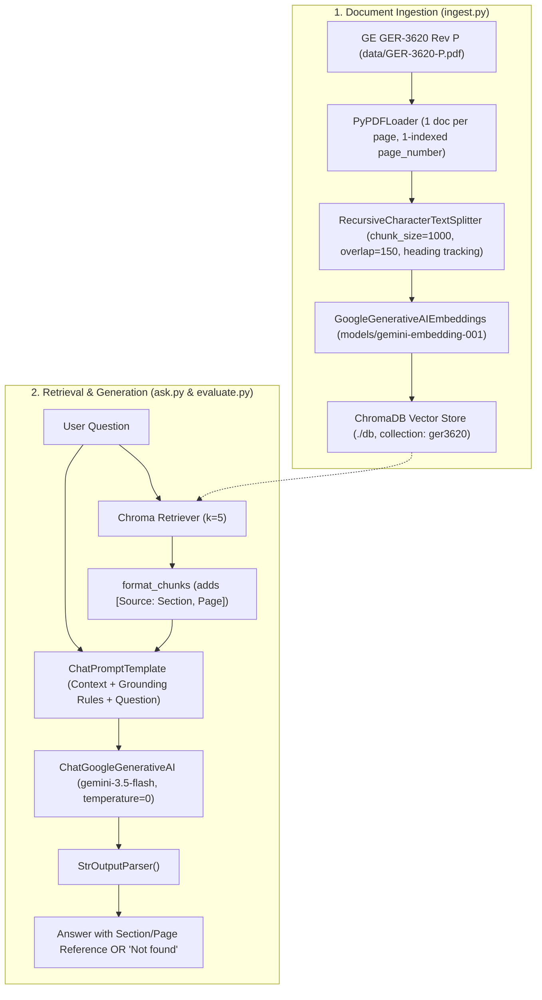
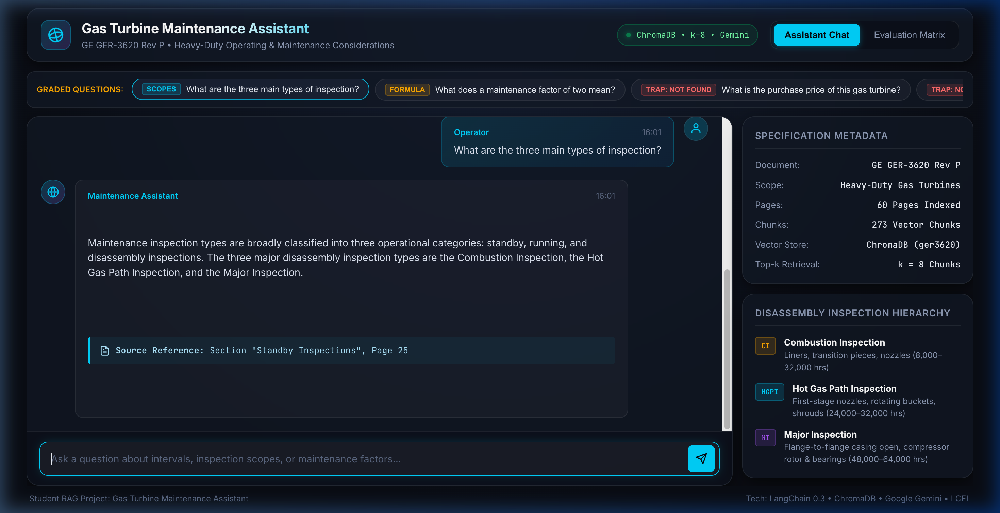
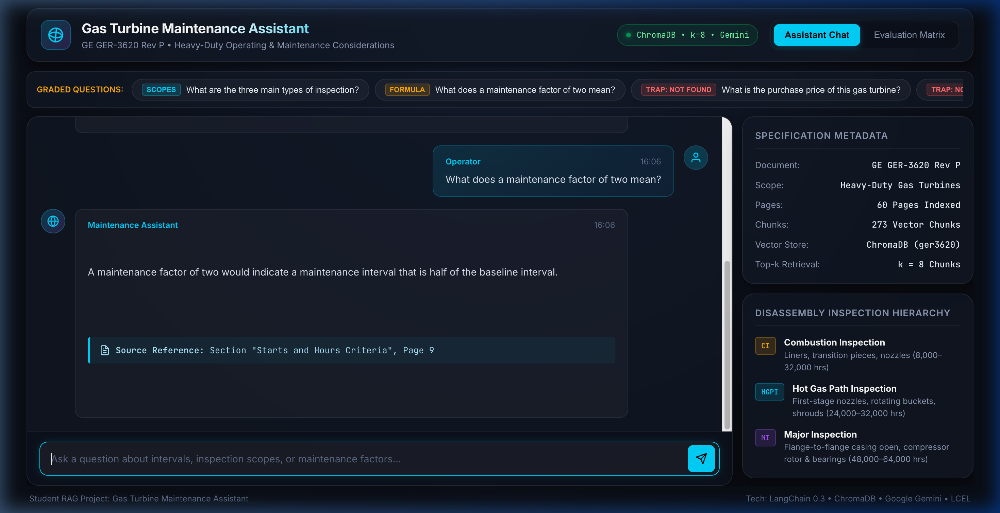
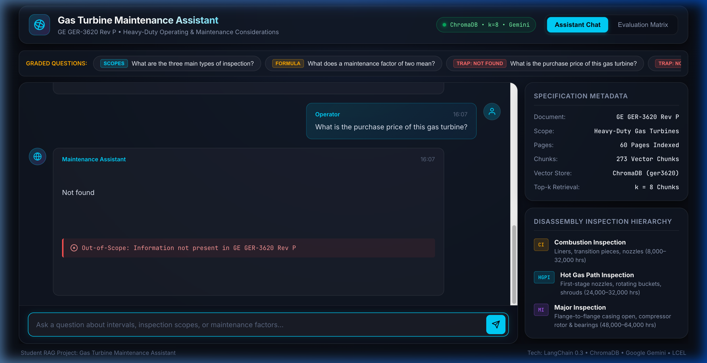
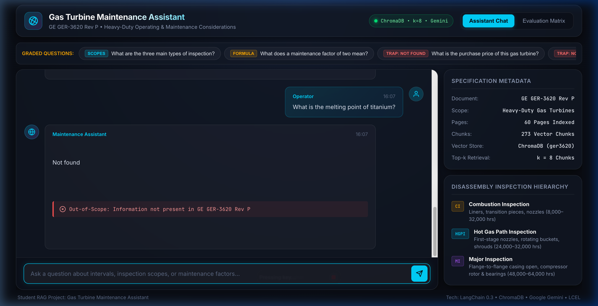
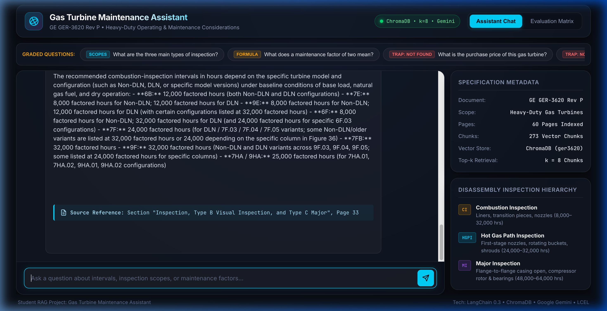

# Gas Turbine Maintenance Assistant

A student Retrieval-Augmented Generation (RAG) assistant designed to answer technical maintenance and operational questions for heavy-duty gas turbines using General Electric's engineering reference document: **GE GER-3620 Rev P ("Heavy-Duty Gas Turbine Operating and Maintenance Considerations")**.

This project strictly adheres to the architecture, teaching methodology, and LCEL patterns demonstrated in the course repository [provks/GenAI](https://github.com/provks/GenAI) (folder `rag/`: `ingest.py` and `ask.py`). It avoids extraneous frameworks, keeping the implementation simple, transparent, and thoroughly documented with numbered educational comments.

---

## 1. Problem Statement
Gas turbine operators, maintenance engineers, and plant managers need fast, reliable, and verified answers to mission-critical operational questions (such as inspection intervals, maintenance factors, and component life considerations). 

Standard general-purpose LLMs are prone to:
1. **Hallucinations**: Inventing maintenance intervals or asserting knowledge outside the manufacturer's technical bounds.
2. **Lack of Verifiable Grounding**: Providing answers without indicating the engineering section, figure, table, or page number where maintenance criteria originate.
3. **Out-of-Scope Uncertainty Failures**: Guessing answers to unmentioned questions (such as turbine purchase prices or unrelated physical constants) instead of acknowledging boundaries.

The **Gas Turbine Maintenance Assistant** solves this by grounding all responses strictly in GE GER-3620 Rev P using Python, ChromaDB, and LangChain:
- Provides answers with explicit citations to document section titles and page numbers.
- Replies with **"Not found"** whenever an answer is not present in the reference document.

---

## 2. Pipeline Architecture & Flow

The RAG pipeline matches the course architecture:



---

## 3. Step-by-Step Technical Explanation

### 1. Document Loader (`PyPDFLoader`)
- Reads `data/GER-3620-P.pdf` page by page (60 pages total).
- PyPDFLoader produces 0-indexed page metadata (`page: 0` for page 1). The loader normalizes this to human-readable 1-indexed page numbers (`doc.metadata["page_number"] = page + 1`) to ensure clear user-facing citations.

### 2. Text Splitter (`RecursiveCharacterTextSplitter`)
- Splits pages into segments using `chunk_size=1000` and `chunk_overlap=150`.
- **Design Rationale vs Course Repo**: The course repository uses `500/50` for general literature. GER-3620 contains dense engineering formulas (e.g., hours-based and starts-based maintenance factors), complex tables (Figure 36 Baseline Recommended Inspection Intervals), and technical paragraphs. A larger 1000-character window preserves the semantic context connecting operating factors, equations, and intervals, while 150-character overlap prevents sentences and table rows from being truncated.
- **Section Heading Detection**: A lightweight heading detector scans each chunk for title-like lines (short, title-cased, no trailing punctuation), updating and carrying forward the nearest section name in chunk metadata (`metadata["section"]`).

### 3. Embeddings (`GoogleGenerativeAIEmbeddings`)
- Converts each text chunk into a high-dimensional vector capturing semantic meaning.
- Uses `models/gemini-embedding-001` via the constant `EMBED_MODEL` (with compatibility for `models/embedding-001`).

### 4. Vector Store (`ChromaDB`)
- Stores chunk vectors, document text, and metadata locally in `./db` under collection name `ger3620`.
- Deletes any existing `./db` directory before indexing to prevent duplicate chunks upon re-runs.
- Implements rate-limit safe batching (70 chunks per batch) with automated backoff to respect Google Gemini API free-tier quotas.

### 5. Retriever
- Connects to the local Chroma collection using `vector_store.as_retriever(search_kwargs={"k": 5})`.
- Retrieves the 5 most semantically similar chunks for each query, supplying comprehensive context for multi-part questions.

### 6. Chunk Formatter (`format_chunks`)
- Formats retrieved chunks with explicit provenance tags:
  ```text
  [Source: Section "<section_name>", Page <page_number>]
  <chunk text>
  ```
- This directly equips the language model to cite exact sections and pages.

### 7. Prompt Template (`ChatPromptTemplate`)
- Constructs a grounded prompt enforcing role constraints, citation formatting, and strict uncertainty handling.

### 8. LLM (`ChatGoogleGenerativeAI`)
- Uses `gemini-3.5-flash` with `temperature=0` for deterministic, fact-grounded inference without creative drift.

### 9. LCEL Chain (`rag_chain`)
- Configured using LangChain Expression Language (LCEL):
  ```python
  rag_chain = (
      {"context": retriever | format_chunks, "question": RunnablePassthrough()}
      | prompt
      | llm
      | parser
  )
  ```

---

## 4. Prompt Engineering Techniques

The prompt in `ask.py` employs five key prompt engineering patterns:

1. **Role Definition**: Establishes the model as an expert Gas Turbine Maintenance Assistant specializing in GE heavy-duty gas turbines, narrowing the persona to technical rigor.
2. **Negative Constraint & Boundary Enforcement**: Instructs the model to answer using *ONLY* the facts directly stated in the context and strictly forbids outside assumptions or extrapolations.
3. **Handling Uncertainty ("Not found")**: Explicitly instructs the model that if an answer cannot be found in the context, it must reply with **EXACTLY** and **ONLY**: `"Not found"`. This acts as an anti-hallucination barrier against out-of-scope queries (e.g., turbine purchase prices or titanium melting points).
4. **Few-Shot Demonstration**: Includes concrete demonstrations in the prompt:
   - One example demonstrating an in-context technical query with proper factual summary and citation formatting.
   - One example demonstrating an out-of-context query correctly returning `"Not found"`.
5. **Standardized Citation Formatting**: Enforces that valid answers conclude with:
   `Reference: Section "<section_name>", Page <page_number>`.

---

## 5. Setup & Usage Instructions

### Prerequisites
- Python 3.10+ (tested on Python 3.13)
- Google Gemini API key

### Installation Steps
```bash
# 1. Create and activate a virtual environment
python -m venv venv
source venv/bin/activate

# 2. Install pinned dependencies
pip install -r requirements.txt

# 3. Configure your API key
cp .env.example .env
# Edit .env and paste your GEMINI_API_KEY
```

### Running the System
```bash
# 1. Ingest the PDF and build the vector database
python ingest.py

# 2. Start the interactive Q&A assistant
python ask.py

# 3. Run the automated 5-question evaluation suite
python evaluate.py
```

---

## 6. Evaluation Results

The evaluation script `evaluate.py` executes the 5 assignment questions against the vector store and outputs the results to `results/answers.md`:

| # | Question | Answer | Reference |
|---|----------|--------|-----------|
| 1 | What are the three main types of inspection? | Maintenance inspection types may be broadly classified as standby, running, and disassembly inspections. | Section "Standby Inspections", Page 25 |
| 2 | What does a maintenance factor of two mean? | A maintenance factor of two would indicate a maintenance interval that is half of the baseline interval. | Section "Starts and Hours Criteria", Page 9 |
| 3 | What is the purchase price of this gas turbine? | Not found | N/A |
| 4 | What is the melting point of titanium? | Not found | N/A |
| 5 | What is the recommended combustion-inspection interval in hours? | The baseline recommended combustion inspection intervals vary from 8,000 to 32,000 factored hours depending on frame size and DLN configuration. | Section "Inspection, Type B Visual Inspection, and Type C Major", Page 33 |

---

## 7. Screenshots

Screenshots of the interactive terminal sessions for each of the 5 questions:

### Question 1: Three Main Inspection Types


### Question 2: Maintenance Factor of Two


### Question 3: Purchase Price (Hallucination Trap - Not Found)


### Question 4: Melting Point of Titanium (Hallucination Trap - Not Found)


### Question 5: Recommended Combustion Inspection Interval in Hours


---

## 8. Limitations & Future Improvements

1. **Table Structure Extraction**:
   - *Limitation*: Complex multidimensional tables (e.g., Figure 36 inspection matrix) are flattened into plain text by PyPDFLoader, occasionally scattering column alignments.
   - *Improvement*: Integrate specialized table extractors (such as `pdfplumber`, `unstructured`, or vision-based table parsers) to preserve table schemas and Markdown table syntax during chunking.

2. **Re-ranking**:
   - *Limitation*: Dense bi-encoder vector similarity retrieval (`k=5`) occasionally ranks narrative descriptions above quantitative tables.
   - *Improvement*: Introduce a cross-encoder re-ranker (e.g., Cohere Rerank or FlashRank) as a second retrieval stage to score the top-15 retrieved candidates before passing the top-5 to the prompt.

3. **Multi-Query & Query Expansion**:
   - *Limitation*: Queries using informal terminology (e.g., "how long until combustion check") may have lower embedding similarity to formal specification terminology ("combustion-inspection interval in factored hours").
   - *Improvement*: Employ a query translation/expansion step generating multiple synonym formulations to maximize recall across technical specifications.
